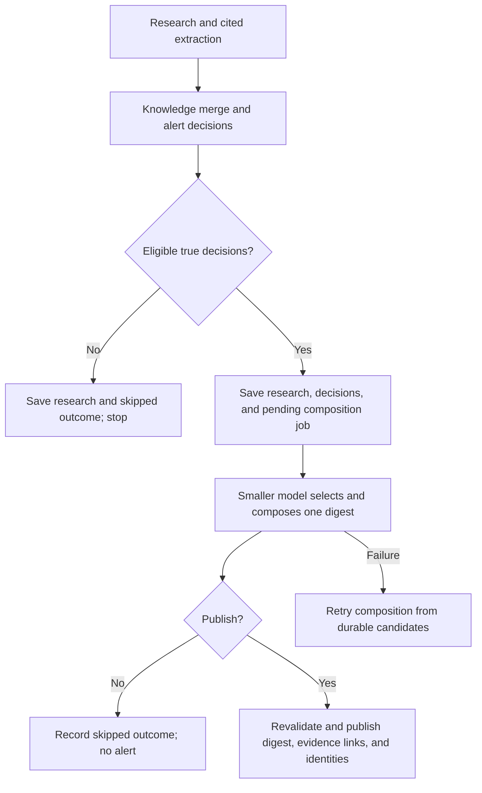

# Alerts: implementation and behavior

Updated: October 30, 2026.

Alert decisions, durable composition, sourced digests, authenticated APIs, and a
monitor Updates panel are implemented. Email/push delivery and periodic scheduling
remain deferred. The observation/source/summary limits from the existing research
pipeline are unchanged; the proposed cost restrictions have not been applied.

See the [overall design and schema](../../docs/HeadsUp_Design_Decisions_and_Schema.md#510-alert)
and [worker guide](monitor-worker.md).

## Workflow

A run produces zero or more observations, each describing one development with
supporting sources. Several articles about the same event support one observation;
independent events remain separate observations. The current response accepts
0–50 observations with 1–20 sources each.

1. Research and extract cited findings using the existing provider calls.
2. Extend the existing knowledge-update call to compare old knowledge, the new
   sourced observations, monitor context, historical observations and previously
   published developments. Return the complete updated knowledge plus explicit
   per-observation alert decisions.
3. Validate decisions and retain only those whose boolean `should_alert` is true.
   Deduplicate their development identities and save research, knowledge,
   decisions, and composition state atomically.
4. Only if eligible true decisions remain, use the separate smaller-model call
   to decide publication and compose at most one digest for the run.
5. Recheck lifecycle, accepted input versions and duplicates, then atomically
   publish the digest with every included observation and development identity.

**Empty decisions, all-false decisions, or only previously published developments
stop the alert workflow before the smaller-model request.** Valid research and
knowledge remain saved, with a terminal `skipped` outcome and no pending
composition work. Malformed, missing, refused, or incomplete model output is an
error, not a negative decision. The smaller model may also explicitly decline
publication after reviewing positive candidates; in that case no alert is created.



In the three-step product description, knowledge/decisions is step 2 and digest
composition is step 3. Because extraction is a separate provider request, live
research with findings normally uses three actual Responses requests; eligible
composition adds a conditional fourth request, with no new search tool call.

## Main knowledge and decision request

`OpenAIResearch.merge_knowledge()` receives frozen previous knowledge, new findings
with backend-assigned `finding_1` references, accepted monitor context, initial-run
state, and this monitor's historical observations/evidence and published alerts.
History is scoped to the owning monitor; no new history-count cap is imposed.
Selective retrieval and tighter context budgets remain future improvements.

The prompt asks for factual changes, practical significance/actionability,
relevance to the objective, evidence quality, uncertainty, and novelty. Rewording
memory is not a development. Useful evidence can update knowledge without alerting.
Absence from the latest run does not justify forgetting previous relevant facts.
The initial check normally establishes a quiet baseline, while currently
actionable information can still justify an alert. Source material cannot change
notification rules, monitor objectives, or personal memory.

Illustrative response:

```json
{
  "content": "The complete updated monitor knowledge...",
  "change_reason": "Updated Company B's application deadline.",
  "alert_decisions": [
    {
      "observation_ref": "finding_2",
      "should_alert": true,
      "what_changed": "Company B moved its deadline to December 1.",
      "why_it_matters": "The user has less time to apply.",
      "development_key": "company-b:internship-2027:deadline:2026-12-01"
    }
  ]
}
```

Live responses must explicitly contain `alert_decisions`, even when empty. Boolean
strings/numbers are rejected. False decisions require a null development key;
true decisions require a nonblank key. References must identify supplied findings
and cannot repeat. Polished messages are generated only in composition.

Temporary references are not database columns on observations. The backend maps
them to saved UUIDs, including when duplicate findings consolidate into one
observation. Only one candidate per consolidated observation/development remains
eligible; other positive decisions are retained as duplicates.

## Deduplication and the final composition request

Canonical development keys identify underlying events/changes, not article URLs,
run IDs, observation UUIDs, titles, or hashes of generated prose. The main prompt
receives published identities and must reuse matching identities; material
follow-ups or supported corrections receive new identities. Backend normalization
folds case and whitespace, and database uniqueness enforces publication once per
monitor/key. Semantic matching still depends on the model and needs evaluation;
different invented keys for the same event can evade exact-key deduplication.

Deduplicate before composition and recheck before publication. Yesterday's A/B
digest followed by today's B/C candidates should produce an update for C only.
A rejected or omitted candidate is not recorded as notified. Different monitors
can independently alert on the same event.

`compose_alert()` receives only eligible candidates with concise reasons, summaries,
saved sources, the objective, and monitor context. It uses `OPENAI_ALERT_MODEL`
(default `gpt-5.4-nano`), separately from `OPENAI_MODEL` (default `gpt-5.4-mini`).
Configure a supported model available to your account; provider availability and
live quality have not been established by fixture/mocked tests.

Its job is to select meaningful developments, group related items, preserve
uncertainty, and write plain-text content using only supplied evidence. It may
return a negative publication decision. The application attaches source URLs;
the composer is instructed not to put URLs in the generated message.

```json
{
  "should_alert": true,
  "reason": "Two actionable changes affect upcoming applications.",
  "title": "Two application updates need your attention",
  "body": "Company A opened applications. Company B moved its deadline earlier...",
  "observation_refs": ["finding_1", "finding_2"]
}
```

```json
{
  "should_alert": false,
  "reason": "The remaining findings add background without a meaningful update.",
  "title": null,
  "body": null,
  "observation_refs": []
}
```

Positive responses require nonblank content and distinct eligible references.
Negative responses require null content and an empty reference list. Unknown
references or inconsistent fields fail validation. Structured Outputs constrains
shape; it does not prove factual accuracy or sound notification judgment.

## Storage and migration

| Table | Responsibility |
| --- | --- |
| `alerts` | One published title/body per run; creation, read, and dismissed timestamps |
| `alert_observations` | Included evidence links and the ledger of published development keys |
| `alert_candidates` | Persisted true/false decisions, reasons, and dispositions |
| `alert_jobs` | Separate composition status, accepted post-merge memory snapshot, attempts and lease |

Unique `alerts.monitor_run_id` enforces at most one digest per run. Composite
foreign keys require every linked observation to belong to the alert's run and
monitor. Unique `(monitor_id, development_key)` on publication links prevents
repeat publication; unique observation IDs prevent duplicate evidence links.
The supported publication transaction requires at least one evidence-backed link.
Published content/evidence have no edit endpoint; read and dismissal state remain
mutable. Monitor hard deletion cascades to decisions, jobs, alerts, and links.
Soft-deleted monitors are excluded by authorization.

Migration `add_alert_digests` replaces the original required single-observation
alert columns and backfills existing alerts into links without changing their
content. If legacy data contains multiple alerts per run, it stops for explicit
consolidation rather than discarding records. Downgrade is supported only when
all alerts have exactly one link; multi-observation digests cannot be represented
by the old schema without loss, so downgrade refuses them.

## Recovery and lifecycle

Research evidence, accepted knowledge/revisions, decisions, research success, and
initial job state commit together. Research success is separate from alert
publication: a completed check can still have pending or failed composition.
The job records the accepted post-merge memory state so the research run does not
invalidate its own pending alert.

Composition uses external requests outside transactions, then publishes the digest,
links, ledger entries, candidate dispositions, and job outcome in one transaction.
A publication failure rolls back the digest/links without erasing successful
research. Only developments actually selected enter the publication ledger.

Job states are `pending`, `processing`, `published`, `skipped`, `failed`, and
`cancelled`. No-positive and final-negative outcomes have distinct reason codes.
Candidates are `pending`, `rejected`, `duplicate`, `excluded`, or `published`.
The final model's selection reason is retained in the terminal job snapshot.

The worker prioritizes due composition jobs. It retries a failed composition
up to three total attempts, after 5 and 15 seconds, without repeating research
or the knowledge update. A 180-second lease permits recovery after a worker
crash, with a 150-second composition timeout and attempt-specific fencing tokens.
Late/repeated completion cannot publish another digest. Exhaustion remains visibly
`failed`, not a no-alert decision. Raw provider error bodies are not logged.

Pending/processing composition blocks a new research claim for that same monitor,
while other monitors remain eligible. Parent-first locks coordinate claims and
publication. Lifecycle/configuration/memory changes are rechecked before sending
and before publishing; stale work becomes `cancelled`. Archived/deleted monitors
cannot publish, and paused monitors allow manual runs only. If candidate identities
change during composition, recompose from the remaining eligible set or skip;
do not publish prose containing removed developments.

## API and monitor UI

All routes require the existing user authentication, authorize through the owned
non-deleted monitor (including for administrators), and use `Cache-Control: no-store`.

| Method | Path | Behavior |
| --- | --- | --- |
| GET | `/monitors/{id}/alerts` | Paginated alerts; optional `unread` and `include_dismissed` filters |
| GET | `/monitors/{id}/alerts/counts` | Unread, undismissed count |
| GET | `/monitors/{id}/alerts/{alert_id}` | Digest with every included observation and its sources |
| PATCH | `/monitors/{id}/alerts/{alert_id}` | Boolean `read` and/or `dismissed`; idempotent timestamps |
| GET | `/monitors/{id}/runs/{run_id}` | Research result plus `alert_processing` and optional published `alert` |

Send `{"read": true}` to mark read, `{"read": false}` to clear it, or
`{"dismissed": true}` to dismiss. Content/ownership edits and null state changes
are rejected. Dismissed alerts are hidden from the default list; reading and
dismissing are independent actions.

The monitor's Updates panel keeps a paginated history of all published digests,
including records previously dismissed through the legacy controls. There is no
frontend dismissal action. Open an update's title or its Open update button to
read the complete message and source evidence in a larger dialog. Opening it
marks it read without removing it from the list; close the dialog or press Escape
to return to the history. The backend dismissal fields/endpoints remain available
for compatibility, but the frontend does not use them to change or filter history.
The check panel distinguishes successful research from pending, skipped, failed,
cancelled, or published alert processing. Generated content is rendered as text.

## Run and verify

From `api/`:

```bash
uv run --locked alembic upgrade head
uv run --locked api-admin worker
```

Use **Administration → Queue** to enable automatic processing or run one item;
the API hosts the managed service and the optional CLI obeys the same saved mode.
Automatic mode defaults to off. See the [queue guide](queue.md).
`--once` handles one due composition attempt, or one research run and its immediate
composition if needed. Queue polling still happens every five seconds and does
not enqueue recurring research.

For a disposable development monitor, use the offline positive-alert fixture:

```bash
uv run --locked api-admin worker --once --fixture docs/examples/alert-result.json
```

This writes synthetic evidence, replaces knowledge with the fixture snapshot,
and can publish an alert in the configured database. It makes no network calls.
Fixture execution does not drain unrelated pending live composition jobs.
Old fixtures that omit decisions produce no alerts. Positive decisions require
an explicit `alert_composition`; references are validated before claiming work.

Tests cover empty/all-false skipping, multiple observations in one digest, A/B
then B/C deduplication, final rejection without ledger entries, strict provider
schemas, ownership, concurrent claims, expired leases, rollback, retries,
exhaustion, stale inputs, and migration backfill/downgrade guards. Live factual
accuracy and alert quality still require representative human-reviewed evaluation.

The [administrator run dashboard](run-dashboard.md) links each run to its saved
decisions, composition state, actual recorded requests, memory snapshots and
published digest. Request tracing applies to future live calls, not old runs.

## Cost and deferred capabilities

The separate composition call is conditional and uses focused candidate inputs.
It permits independent retries but is not automatically cheaper than a single
combined call. Compare usage, latency, missed important updates, unnecessary
alerts, factual accuracy, deduplication, and source attribution on the same cases.
No new observation, history, or output-token restrictions were added for this feature.

Email/push requires a future durable delivery outbox with attempts/provider IDs
and idempotency. Sending, reading, and dismissing remain different events.
Automatic scheduling, reminders/carryover of excluded candidates, stronger semantic
identity matching, selective historical retrieval, per-attempt model/prompt audits,
and configurable notification thresholds remain future work.

Official references: [Structured Outputs](https://developers.openai.com/api/docs/guides/structured-outputs?api-mode=responses),
[composition model](https://developers.openai.com/api/docs/models/gpt-5.4-nano),
[request tradeoffs](https://developers.openai.com/api/docs/guides/latency-optimization),
and [evaluation](https://developers.openai.com/api/docs/guides/evaluation-best-practices).
These support the implementation; the product choices above are HeadsUp decisions.

## Observation and request-size budgets

Current code accepts up to 50 observations, up to 20 sources per observation,
and summaries up to 20,000 characters. It sends the full validated observation
batch into the knowledge merge. There is currently no explicit `max_output_tokens`
in the provider requests and no overall input-token budget. Existing `.env`
settings do not provide configurable observation limits.

Suggested starting limits for evaluation, **not implemented or applied**:

| Item | Suggested initial limit |
| --- | --- |
| New observations per run | 5 |
| Summary per observation | 1,000 characters, preserving material facts and uncertainty |
| Supporting sources per observation | 3 strongest relevant sources |
| Historical observations included per merge | Up to 5 relevant records, also bounded by total input size |
| Positive candidates sent to composition | At most the number of selected new observations; never unbounded |

Use several controls together:

1. Ask research/extraction to prioritize at most five distinct developments
   relevant to the objective, consolidate duplicates, keep summaries concise,
   and allow zero results. A prompt is guidance, not sufficient enforcement.
2. Change `Extraction.observations` and `ResearchResult.observations` together
   in `app/schemas/research.py`. Their Pydantic `max_length` becomes JSON Schema
   `maxItems` for the extraction request and also validates the backend result.
   Align summary limits in `Finding` and `ExtractedFinding`, and source limits
   in `Finding.sources` and `ExtractedFinding.source_ids`. Verify the selected
   model supports the emitted schema constraints; retain application validation.
3. Apply token budgets to the entire serialized input: instructions, objective,
   current knowledge, new observations, source metadata, retrieved history, and
   previous alerts. A small observation count alone cannot bound this input.
   Select relevant history and concise evidence before sending, maintaining
   valid provenance and complete material facts. Do not blindly truncate JSON
   or erase accepted knowledge to fit a request.
4. Set stage-specific `max_output_tokens` with enough room for complete JSON and
   any reasoning tokens. Extraction and composition can have smaller budgets
   than a complete knowledge snapshot. Too-low limits can produce an incomplete
   response; handle that as a bounded retry/failure, never as “no observations”
   or “no alert.” Choose values by measuring representative runs, not by assuming
   a fixed character-to-token ratio.
5. Record actual usage and coverage limits. Cutting a generated response after
   receiving it does not recover its generation cost. Automatically batching every
   overflow item into more requests can defeat the intended per-run budget.
   A capped selection is bounded coverage, not proof that no other developments
   exist; communicate/record that limitation rather than silently claiming an
   exhaustive check.

Observation caps limit extraction output and later inputs; they do not independently
cap the initial web-research request, search-tool usage, or total cost. Those
require separate request/tool budgets and usage measurement. Final numeric budgets
and overflow policy remain to be chosen after evaluation.

Official guidance: [array limits in Structured Outputs](https://developers.openai.com/api/docs/guides/structured-outputs?api-mode=responses),
[counting tokens and output limits](https://developers.openai.com/api/docs/guides/token-counting),
and [handling incomplete reasoning responses](https://developers.openai.com/api/docs/guides/reasoning).

## Inspect published storage

```bash
docker compose exec db psql -U headsup -d headsup -c '\d alerts'
docker compose exec db psql -U headsup -d headsup -c 'SELECT id, title, created_at FROM alerts ORDER BY created_at DESC LIMIT 20;'
```
